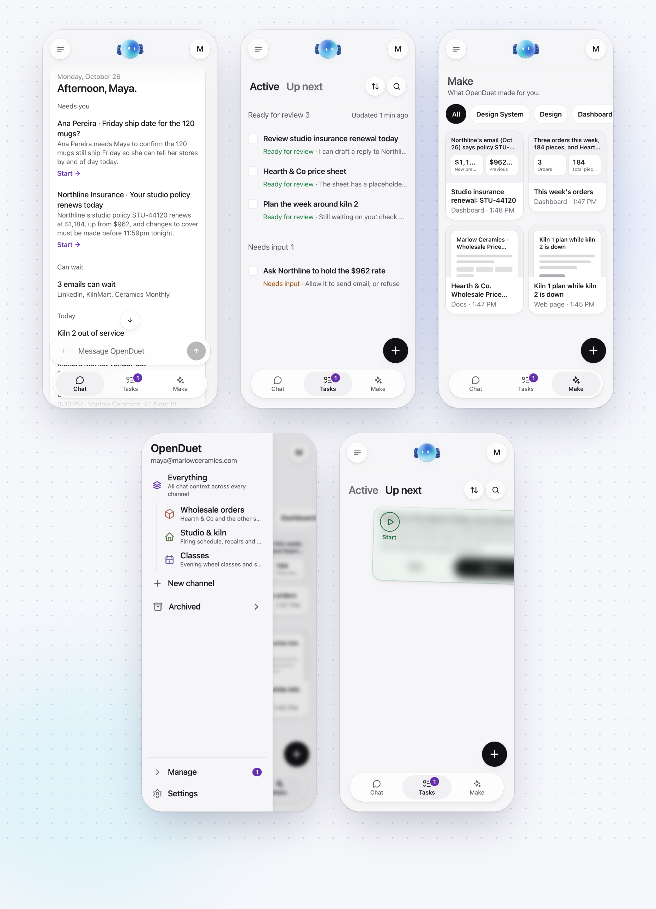
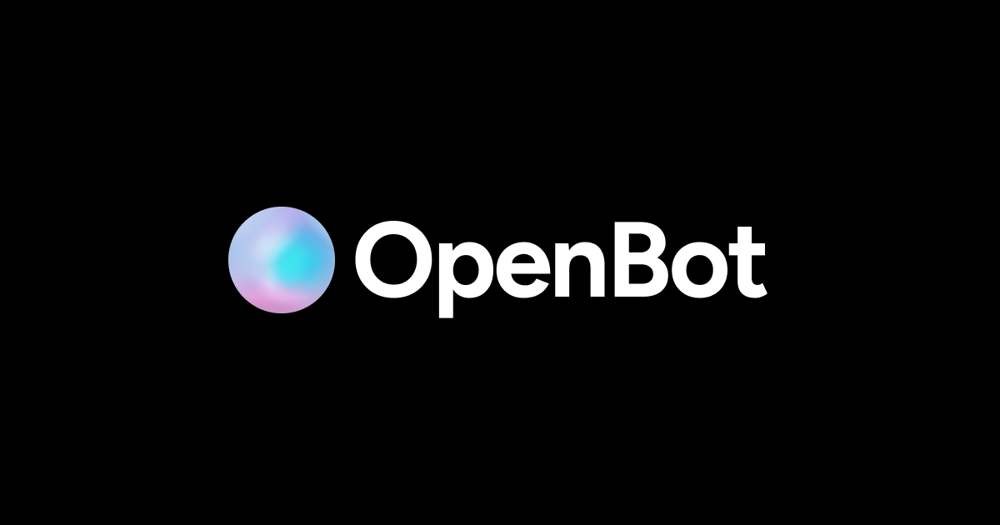

<div align="center">

# OpenDuet

### An open-source proactive agent that gets your work done and keeps you in the loop

Built on [OpenBot](https://github.com/CopilotKit/openbot) and [CopilotKit](https://docs.copilotkit.ai) · [Quick start](#quick-start) · [Overview](#overview) · [Features and Capabilities](#features-and-capabilities) · [How it works](#how-it-works) · [Contributing](#contributing)

[](https://github.com/CopilotKit/openbot)
[](./LICENSE)


 **Each agent has a computer of its own. Use it on the web, on mobile, in Slack, or in Microsoft Teams.**

Host OpenDuet yourself and choose your own model. Requires a free [CopilotKit Intelligence](https://docs.copilotkit.ai) project for threads and memory. Everything that makes it OpenDuet lives in [one folder](#make-it-your-own), so copy it and make it your own.

[**Building on OpenDuet? Talk to a CopilotKit engineer →**](https://www.copilotkit.ai/talk-to-an-engineer?ref=openduet_readme)

</div>

---

<div align="center">

<table><tr><td>

https://github.com/user-attachments/assets/f3439f74-855e-4d95-bb5c-713fded3c66e

</td></tr></table>

Setting it up takes a minute: onboarding ends on a checklist of what OpenDuet depends on.

<table><tr><td>

https://github.com/user-attachments/assets/55b74b87-708e-4e69-af1e-16e4071ead95

</td></tr></table>

</div>

## Overview

OpenDuet does not wait to be asked. It starts your day with a short brief, keeps working on a computer of its own while you step away, and comes back only when something needs you. Before it sends, pays, signs, or deletes anything, it shows you exactly what it is about to do and waits for your answer.

**Early, and in active development.** OpenDuet runs today as [OpenBot](https://github.com/CopilotKit/openbot), CopilotKit's open-source, self-hosted agent platform, with OpenDuet's name, Bots and skills on top. It already reads your Gmail and calendar, sorts what needs you from what can wait, and makes the morning brief. [Features and Capabilities](#features-and-capabilities) lists what works today. Expect things to move. Issues and ideas are welcome.

## What it does

- **A morning brief.** One short message to start the day: what is on, what changed, and what needs a decision from you.
- **What needs you, and what can wait.** It looks across your mail, calendar, and Slack, brings the few things that need you to the top, and holds the rest until they matter.
- **Keeps working when you step away.** Hand it a task and it carries on in a computer of its own: a real browser, its own files, and only the tools you grant. It tells you when it is done, or when it is stuck.
- **Asks before it acts.** Sending a message, making a payment, signing a document, deleting anything: it shows you the exact action and waits. Allow once, always allow, or refuse.
- **Never sees your passwords.** When a site needs a login, you type it into a masked box. The password reaches the site, never the conversation the agent reads.
- **Checks what leaves.** Every outgoing message is checked for sensitive information, so a card number or a health detail does not go out by accident.
- **Yours to run.** Self-host it, choose your own model, and keep your data in your own database.

See [Features and Capabilities](#features-and-capabilities) for what works today.

<p align="center">
  
</p>

## Features and Capabilities

Everything below works today when you run this repository.

| Capability                   | What it means for you                                                                 |
| ---------------------------- | ------------------------------------------------------------------------------------- |
| A computer of its own        | Keeps working in its own browser, `/workspace`, and shell while you are away. |
| Asks before it acts          | A reviewer checks every action that changes something, and the ones that matter pause for **Refuse**, **Allow once**, or **Always allow**. A message to other people always asks, once, showing who it goes to and what it says. Anything you type while it carries an action out waits its turn and is answered after. Every action is checked against policy and recorded. |
| Never sees your passwords    | Logins go through a masked secret box. Saved credentials are encrypted and write-only. |
| Memory                       | Threads and memory carry over through CopilotKit Intelligence. |
| Skills                       | Reusable instructions you write once and call with `/`. |
| Gmail and Google Calendar    | Each person connects their own account. OpenDuet reads mail and today's calendar, and sends a reply only after you answer. |
| Connected apps               | Governed MCP connectors, including Google Drive and Notion. |
| Scheduled work               | Routines: ask it to do something on a schedule and it runs as you. |
| Make it your own             | Its name, Bots, channels, model, and skills live in one folder, [`openbot/examples/openduet`](openbot/examples/openduet). |
| What needs you, what can wait | Sorts new mail into what needs you and what can wait, with a one-line reason for each. Measured on a labelled set in [`evals/triage`](evals/triage). |
| Morning brief                | The first time you open Chat each day after your first, it is already there: what needs you and why, what can wait, today's calendar, and anything it could not check, posted once a day however many tabs or devices you open. You can also ask for it any time. **Start** on a row that needs you hands that email to OpenDuet. |
| Tasks                        | One tab for what needs you, answered right there, what OpenDuet suggests from its background research, and what it is working on. Its newest suggestion also waits above Chat's composer, with **Start** and **Hide**. A suggestion you start stays in view: under **Working** while OpenDuet works, then **Ready for review** or **Needs input** with OpenDuet's next step, opening at its own message. Answer it in Chat, on its card or by deciding its approval, and it goes back to **Working** until OpenDuet replies. A run that fails says why, with **Try again** where running it again can help. Check one off and it folds into **Resolved**. |
| Setup checklist              | Onboarding asks you to connect Gmail and Calendar and to turn on notifications, each with **Not now**, then ends on a list of what OpenDuet depends on: Intelligence, the model key, Google, your Gmail and Calendar, notifications, and the optional extras. Each is **Ready**, **Not checked** or **Needs setup**, from the real answer, with how to fix it. **Check again** asks Intelligence and the model provider again. **Settings → Setup** opens it again. |
| Gets to know you             | On your first day it speaks first: it greets you, reads your recent mail and this week's calendar, then answers in three short bubbles (who you are, three ways it can help, and an invitation to correct it), with **Sounds right** and **Something's off** to tap. With Gmail and Calendar not connected, it promises no mail: it says what it can do now and shows the card to connect them. |
| Make                         | Ask for a design system, a design, a dashboard, slides, a doc or a web page, or pick one from the **+** on the Make tab, and OpenDuet makes it. A card in Chat opens it, and Make keeps everything it made as thumbnails you can filter by kind. |
| Channels                     | Make a channel for a piece of work: a name, an icon in a colour, and what it is for. OpenDuet says hello there and offers three things it could start on, keeps the work there about that purpose, and the tasks it starts there wear the channel's colour. Everything stays your one thread, and the menu lists your channels with Archived folded under them. |
| Answers in a tap             | When it asks you to choose, the likely answers appear as replies you can tap. |
| Light or dark                | Follows your phone's setting, changing with it, or pick Light or Dark in Settings. |
| Say it instead               | Tap the voice button in Chat and say everything you need to do. It is written down and sent as your message. Needs a speech-to-text provider on the server (`TRANSCRIPTION_*`). |

## Quick start

You will need Docker, [Bun](https://bun.sh) 1.3 or newer, Node (for `npx`, which runs the CopilotKit CLI), a model key, and a CopilotKit Intelligence project. **Intelligence is required**: it keeps OpenDuet's threads and memory, and the server will not start without its key. The free Developer plan is enough.

Run every command in this section from the repository root.

```sh
git clone https://github.com/CopilotKit/OpenDuet.git
cd OpenDuet
cp .env.example .env
bun install
```

Sign in and pick an Intelligence project:

```sh
npx --yes copilotkit@latest login
npx --yes copilotkit@latest project select
bun openbot/scripts/setup-learning.ts
```

`project select` writes the project's key to `.env` as `CPK_INTELLIGENCE_API_KEY`, its telemetry ID as `CPK_TELEMETRY_ID`, and your choice to `.copilotkit/project.json`. The server reads `INTELLIGENCE_API_KEY`, not `CPK_INTELLIGENCE_API_KEY`, so the last command finishes the job. It makes sure the project has an `openbot` Learning container, creating one if it does not (see [Automatic Learning](openbot/docs/automatic-learning.md)), then copies the key to `INTELLIGENCE_API_KEY` and sets `CPK_INTELLIGENCE_LEARNING_CONTAINER_ID=openbot`. It reads `.env` and `.copilotkit/` from the directory it runs in, which is why it runs here and not from `openbot/`. If `.env` already has an `INTELLIGENCE_API_KEY`, it keeps it and only checks that the container exists.

Put your model key in `.env`. The OpenDuet Bot runs OpenAI's `gpt-5.6-terra`, set in `openbot/examples/openduet/model.yaml`, so by default that is:

```sh
OPENAI_API_KEY=sk-...
```

To use another provider or model:

- **Another OpenAI model.** Change `default_model` in `openbot/examples/openduet/model.yaml`, or in your copy of it (see [Make it your own](#make-it-your-own)). `BOT_MODEL` does not change an OpenAI model on its own. It is used only when `OPENAI_BASE_URL` is also set to an OpenAI-compatible endpoint, and then it names the model that endpoint serves.
- **Anthropic.** Set `BOT_PROVIDER=anthropic` and `ANTHROPIC_API_KEY=...`. The model is `BOT_MODEL` if you set one, such as `BOT_MODEL=claude-sonnet-5-5`, and `claude-sonnet-4-5` if you do not.

Set these before you start it. **Settings → Setup** in the app says whether the model key works.

Then start it:

```sh
bash scripts/start.sh
```

and open <http://localhost:3010>. The script starts Postgres and each Bot's computer in Docker, applies the database migrations, and starts the API server, the routine worker, and the app. It checks that each one answers before it prints the next steps. `bash scripts/stop.sh` stops the app, the worker, the API server and the Docker services, and removes the Bot computers that belong to this install, the ones with its `COMPUTER_NAMESPACE`. It does not touch another install's. The database, each Bot's files and its browser profile are Docker volumes, so they stay. Add `--keep-computers` to leave the Bot computers running.

If port 5432 is already taken on your machine, set `POSTGRES_PORT` in `.env` to a free port and change the port in `DATABASE_URL` to match.

For a shared Bot computer, set `OPENBOT_ONE_COMPUTER_EACH=false`, leave `COMPUTER_SUPERVISOR_URL` empty, and point `AGENT_COMPUTER_URL` at `http://localhost:<COMPUTER_PORT>` (4100 by default). The API and the `agent-computer` Compose service must use the same nonempty `COMPUTER_TOKEN`. Start through `bash scripts/start.sh` to keep them in agreement; it writes the resolved token into `.env` so a later direct Bun restart keeps it. If you change the token, rerun the start script and restart any API processes launched manually. For a computer per Bot, keep `OPENBOT_ONE_COMPUTER_EACH=true`: the supervisor owns those containers and their assigned ports; do not point `AGENT_COMPUTER_URL` at a remembered random port.

To run a second install beside another on one machine, give it its own `COMPOSE_PROJECT_NAME`, `COMPUTER_NAMESPACE`, image tags (`COMPUTER_IMAGE` and the other `*_IMAGE` settings), and a value for every `*_PORT`. Change the addresses built from those ports to match: `DATABASE_URL`, `AGENT_COMPUTER_URL`, `MANAGED_AGENT_AG_UI_URL`, `OPENBOT_PUBLIC_URL` and `TRUSTED_ORIGINS`. If both use the same Intelligence project, give it its own `DEPLOYMENT_ID` too. [openbot/docs/configuration.md](openbot/docs/configuration.md#ports) lists them. Two installs can instead share one computer, if they use the same token.

To diagnose a 401, inspect container names and port mappings with `docker ps`, then compare `COMPUTER_TOKEN` by equality without printing either value. The setup checklist authenticates against the provider and checks network-policy delivery; a configured URL alone no longer means Ready. A sleeping computer reads Not checked until it is running and **Check again** succeeds.

The CopilotKit runtime sends usage telemetry to CopilotKit, tagged OpenDuet. Set `COPILOTKIT_TELEMETRY_DISABLED=true` or `DO_NOT_TRACK=1` to turn it off. [What is sent](docs/telemetry.md).

Once it is running, try the parts that work today:

- Ask the OpenDuet Bot to do something in its own browser, and watch it work on its computer.
- Choose what it must ask you about first in `/settings/approvals`.
- Ask it to do something on a schedule. You will find it in `/routines`.

Sign-in for a team, and Slack and Teams, are OpenBot's: see [openbot/docs](openbot/docs/README.md). A hosted or deploy guide for OpenDuet is not published yet, and neither is an OpenDuet image, so the Quick start above is the supported way to run it today. The Docker and Helm guides in `openbot/docs` deploy plain OpenBot from OpenBot's own image, not OpenDuet.

### Connect Gmail and Google Calendar

Gmail and Calendar need a Google OAuth client, which an administrator registers once. Each person then connects their own account under **Connections**. With the default `.env` you are the administrator. **Settings → Setup** in the app shows which of these steps is still open and links to each page. [openbot/docs/plugins/google-workspace.md](openbot/docs/plugins/google-workspace.md) has the Google Cloud steps: the two APIs to enable, the consent screen, and the OAuth client.

Connecting needs `OPENBOT_PUBLIC_URL`, the API's address that Google sends people back to. `.env.example` sets it to `http://localhost:3001`, so it has to change if you move `SERVER_PORT`, and it must be the public address once deployed.

To try it without a Google account, use the fake Google that ships for tests and demos. Setting its URL is not enough on its own. The steps are:

1. Start the fake Google. It serves an invented inbox and calendar.

   ```sh
   bun openbot/scripts/fake-google/server.ts --port 4900
   ```

2. In `.env`, set `OPENDUET_FAKE_GOOGLE_URL=http://127.0.0.1:4900`, then start OpenDuet. If it is already running, run `bash scripts/stop.sh` and `bash scripts/start.sh`, because the API reads `.env` only when it starts.
3. Open `/admin/plugins/google-workspace`. Turn on **Enable for this deployment**, open **OAuth client** and paste any client ID and secret (the fake accepts anything), then press **Refresh tools**.
4. Grant the connector's tools to the OpenDuet Bot at `/admin/plugins/google-workspace/bots/openduet`.
5. Open `/connections/google-workspace` and press **Connect**. The fake consents at once, as `maya@marlowceramics.com`, and sends you straight back.

`OPENBOT_PUBLIC_URL` has to match the API's port, because the fake sends you back through it. `curl http://127.0.0.1:4900/__fake/sent` shows anything OpenDuet sent. The variable is ignored when `NODE_ENV=production`. To switch to real Google, remove it, restart, and connect again: the stored sign-in belongs to the fake.

## Make it your own

OpenDuet is meant to be copied. Everything that makes it OpenDuet rather than OpenBot is in [`openbot/examples/openduet`](openbot/examples/openduet):

| File            | What it decides                                                       |
| --------------- | --------------------------------------------------------------------- |
| `brand.yaml`    | The product's name, everywhere in the app.                            |
| `agents.yaml`   | The Bots, their instructions, and which skills each one holds.        |
| `channels.yaml` | The conversations people see, and which Bots answer in each.          |
| `model.yaml`    | The model provider and default model.                                 |
| `skills.yaml`   | Instructions anyone can call with `/`, and the tools each one needs.  |

Copy the folder, change it, and point `TENANT_PACKAGE_DIR` in `.env` at your copy (relative to `openbot/server`). OpenBot's code underneath stays as it is in `openbot/`, so OpenBot's fixes can still be brought in.

## What is in this repository

| Path                  | What it is                                                                                         |
| --------------------- | -------------------------------------------------------------------------------------------------- |
| `openbot/`            | The platform OpenDuet runs on: [OpenBot](https://github.com/CopilotKit/openbot)'s server, app, worker, each Bot's computer, Docker and Helm files. |
| `openbot/examples/openduet` | OpenDuet's tenant package: its name, Bots, channels, model and skills.                       |
| `scripts/`            | `start.sh` and `stop.sh`, which run OpenBot's scripts with this repository's `.env`.               |
| `docs/`               | What OpenDuet sends as telemetry, and how to turn it off. OpenBot's own documentation is in `openbot/docs`. |
| `assets/`             | The banner.                                                                                        |

## Built on OpenBot

<p align="center">
  <a href="https://www.copilotkit.ai/openbot"></a>
</p>

OpenDuet is built on top of [OpenBot](https://github.com/CopilotKit/openbot), CopilotKit's open-source, self-hosted agent platform. OpenBot provides the server, the app, each Bot's computer, the approval boundary, the audit trail, sign-in, and the Slack and Teams channels. OpenDuet adds the morning brief, Tasks, Make and its own Bots and skills on top; its name, Bots and skills live in one folder, [`openbot/examples/openduet`](openbot/examples/openduet). To build a different assistant on the same foundation, start from [OpenBot](https://github.com/CopilotKit/openbot), or read more at [copilotkit.ai/openbot](https://www.copilotkit.ai/openbot).

## How it works

Everything below works in this repository today.

```text
You: web · Slack / Microsoft Teams
        │                             ▲
        │ asks, answers, approvals    │ morning brief, "this needs you"
        ▼                             │
OpenDuet server   (OpenBot: Hono + CopilotKit runtime)
  ├── triage          what needs you / what can wait
  ├── approvals       Allow once · Always allow · Refuse
  └── gateway         policy → audit record → act
        │ AG-UI
        ▼
Agent   (any AG-UI agent, on a framework or hand-written)
        │ every tool call comes back through the gateway
        ▼
Its own computer   Chromium · /workspace · shell

CopilotKit Intelligence   threads and memory
PostgreSQL + pgvector     policy, approvals, audit, encrypted credentials
MCP connectors            Google Drive, Notion, and more through Composio
```

**Channels.** You reach OpenDuet where you already are: the web app, Slack, or Microsoft Teams, all of which OpenBot supports today.

**Server.** OpenBot's server hosts the CopilotKit runtime and sends each turn to the agent over [AG-UI](https://github.com/ag-ui-protocol/ag-ui). OpenDuet adds two pieces in front of it: a triage step that decides what needs you and what can wait, and a morning brief built from it. Both build on OpenBot's routines, which give an agent scheduled turns that run as you.

**Agent.** Any endpoint that speaks AG-UI can be the agent, whether it is built with LangGraph, Mastra, CrewAI, Pydantic AI, Google ADK, or written by hand. OpenDuet is not tied to one framework or one model.

**Its own computer.** Each agent gets a container of its own, with Chromium, a `/workspace` volume, a browser profile, and a shell. That is where it keeps working while you step away. When it hits a login wall or a two-factor prompt, it asks for help and you can take the wheel.

**Approvals.** Every action the agent takes goes through one gateway. The gateway checks the action against your policy, writes an audit record, and only then acts. Actions set to ask pause and show you the exact action and the rule that asked, with **Allow once**, **Always allow**, and **Refuse**. Deny rules refuse an action outright. OpenDuet's defaults will ask before anything that sends, pays, signs, or deletes.

**Passwords and credentials.** When a site needs a secret, the agent asks for it through a masked box. The value goes to the site; the transcript records only that a secret was requested. Credentials you store are encrypted at rest, write-only, never returned by an API, and redacted from audit events.

**What leaves.** OpenBot treats any tool it cannot positively classify as a read as a write, and redacts secrets from its audit trail. A message to other people always asks first, showing who it goes to and what it says.

**Memory.** Threads and memory live in [CopilotKit Intelligence](https://docs.copilotkit.ai), so conversations survive restarts and what it has learned about you carries over. You can see what it remembers about you, and tell it facts directly.

**Skills and connectors.** Skills are instructions you write once and call with `/`. Connected apps are governed MCP servers: Google Drive and Notion ship in OpenBot's catalogue, and Composio brokers more. A connector is granted to an agent before it can be used.

## Contributing

OpenDuet is early, so please open an issue before starting substantial work. Much of the foundation lives in [OpenBot](https://github.com/CopilotKit/openbot): changes to the computer, the gateway, approvals, credentials, or connectors usually belong there.

## About

OpenDuet is built and maintained by [CopilotKit](https://www.copilotkit.ai), the team behind [OpenBot](https://github.com/CopilotKit/openbot) and the [AG-UI protocol](https://github.com/ag-ui-protocol/ag-ui).

It is CopilotKit's open-source take on the proactive-agent category: assistants that reach out first, such as Claude Duet. OpenDuet is an independent project and is not affiliated with or endorsed by Anthropic.

**Rolling it out at your company?** [Talk to a CopilotKit engineer.](https://www.copilotkit.ai/talk-to-an-engineer?ref=openduet_readme)

- [copilotkit.ai/openduet](https://www.copilotkit.ai/openduet): OpenDuet's page
- [Discord](https://discord.gg/6dffbvGU3D): ask a question or share what you are building
- [@copilotkit on X](https://x.com/copilotkit): releases and what is shipping
- [docs.copilotkit.ai](https://docs.copilotkit.ai): CopilotKit documentation

## License

[MIT](./LICENSE) © CopilotKit
