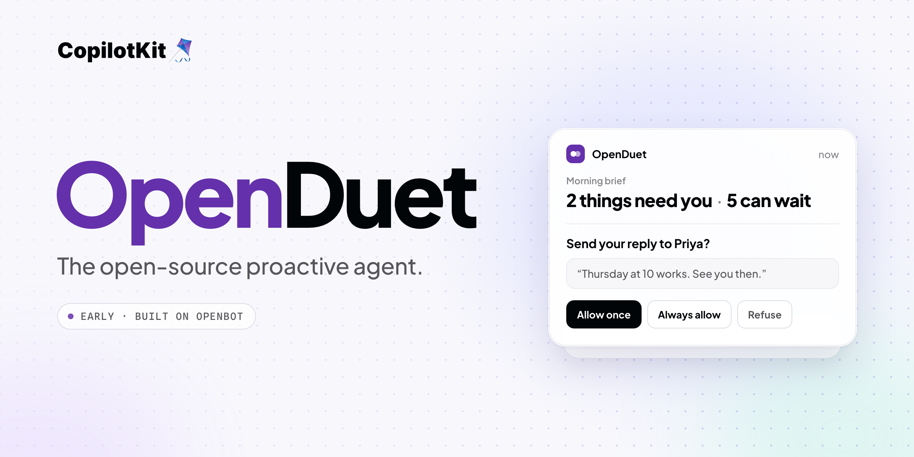

<div align="center">

# OpenDuet

**The open-source proactive agent. It tells you what needs you, handles what can wait, and asks before it acts.**

[**What it does**](#what-it-does) · [**Status**](#status) · [**Quick start**](#quick-start) · [**Make it your own**](#make-it-your-own) · [**How it works**](#how-it-works) · [**OpenBot**](https://github.com/CopilotKit/openbot)

[](https://github.com/CopilotKit/openbot)
[](./LICENSE)


**[Building on OpenDuet? Talk to a CopilotKit engineer →](https://www.copilotkit.ai/talk-to-an-engineer?ref=openduet_readme)**

</div>



<div align="center">

Most assistants wait to be asked. OpenDuet starts your day with a short brief,
keeps working on a computer of its own while you step away, and comes back only
when something needs you. Before it sends, pays, signs, or deletes anything, it
shows you exactly what it is about to do and waits for your answer.

</div>

> **Early, and in active development.** OpenDuet runs today as [OpenBot](https://github.com/CopilotKit/openbot), CopilotKit's open-source, self-hosted agent platform, with OpenDuet's name, Bots and skills on top. Watching your mail and calendar, sorting what needs you, and the morning brief are being built now. The [status table](#status) says which parts work and which do not yet. Expect things to move. Issues and ideas are welcome.

## What it does

- **A morning brief.** One short message to start the day: what is on, what changed, and what needs a decision from you.
- **What needs you, and what can wait.** It looks across your mail, calendar, and Slack, brings the few things that need you to the top, and holds the rest until they matter.
- **Keeps working when you step away.** Hand it a task and it carries on in a computer of its own: a real browser, its own files, and only the tools you grant. It tells you when it is done, or when it is stuck.
- **Asks before it acts.** Sending a message, making a payment, signing a document, deleting anything: it shows you the exact action and waits. Allow once, always allow, or refuse.
- **Never sees your passwords.** When a site needs a login, you type it into a masked box. The password reaches the site, never the conversation the agent reads.
- **Checks what leaves.** Every outgoing message is checked for sensitive information, so a card number or a health detail does not go out by accident.
- **Yours to run.** Self-host it, choose your own model, and keep your data in your own database.

Some of this works today through OpenBot, and some of it is being built now. See [Status](#status).

## Status

**Available today via OpenBot** means it works when you run this repository today, and the code comes from [OpenBot](https://github.com/CopilotKit/openbot), which OpenDuet is built on. **In progress** means it is new work for OpenDuet and does not work yet.

| Capability                   | What it means for you                                                                 | Status                      |
| ---------------------------- | ------------------------------------------------------------------------------------- | --------------------------- |
| A computer of its own        | Keeps working in its own browser, `/workspace`, and shell while you are away.         | Available today via OpenBot |
| Asks before it acts          | A reviewer checks every action that changes something, and the ones that matter pause for **Refuse**, **Allow once**, or **Always allow**. Messages to other people always ask. Every action is checked against policy and recorded. | Available today via OpenBot |
| Never sees your passwords    | Logins go through a masked secret box. Saved credentials are encrypted and write-only. | Available today via OpenBot |
| Memory                       | Threads and memory carry over through CopilotKit Intelligence.                        | Available today via OpenBot |
| Skills                       | Reusable instructions you write once and call with `/`.                               | Available today via OpenBot |
| Connected apps               | Governed MCP connectors, including Google Drive and Notion.                           | Available today via OpenBot |
| Scheduled work               | Routines: ask it to do something on a schedule and it runs as you.                    | Available today via OpenBot |
| Make it your own             | Its name, Bots, channels, model, and skills live in one folder, [`openbot/examples/openduet`](openbot/examples/openduet). | Available today via OpenBot |
| Watching mail, calendar, Slack | Notices new mail, calendar changes, and Slack messages without being asked.          | In progress                 |
| What needs you, what can wait | Sorts what comes in by how much it needs you.                                        | In progress                 |
| Morning brief                | One message to start the day, built from what it watched and sorted.                  | In progress                 |
| Sensitive-info check         | A check on every outgoing message. OpenBot today classifies each tool as a read or a write and redacts secrets from its audit trail. | In progress |
| Phone inbox                  | One place on your phone for everything waiting on you.                                | In progress                 |

## Quick start

You will need Docker, [Bun](https://bun.sh) 1.3 or newer, a model key, and a CopilotKit Intelligence project. **Intelligence is required**: it keeps OpenDuet's threads and memory, and the server will not start without its key. The free Developer plan is enough.

```sh
git clone https://github.com/CopilotKit/OpenDuet.git
cd OpenDuet
cp .env.example .env
bun install
```

Sign in and pick an Intelligence project. These write the project's key and its telemetry ID to `.env`:

```sh
npx --yes copilotkit@latest login
npx --yes copilotkit@latest project select
bun scripts/setup-learning.ts
```

Put your model key in `.env`:

```sh
OPENAI_API_KEY=sk-...
```

Then start it:

```sh
bash scripts/start.sh
```

and open <http://localhost:3010>. The script starts Postgres and each Bot's computer in Docker, applies the database migrations, and starts the API server, the routine worker, and the app. It checks that each one answers before it prints the next steps. `bash scripts/stop.sh` stops all of it and deletes nothing.

If port 5432 is already taken on your machine, set `POSTGRES_PORT` in `.env` to a free port and change the port in `DATABASE_URL` to match.

The CopilotKit runtime sends usage telemetry to CopilotKit, tagged OpenDuet. Set `COPILOTKIT_TELEMETRY_DISABLED=true` or `DO_NOT_TRACK=1` to turn it off. [What is sent](docs/telemetry.md).

Once it is running, try the parts that work today:

- Ask the OpenDuet Bot to do something in its own browser, and watch it work on its computer.
- Choose what it must ask you about first in `/settings/approvals`.
- Ask it to do something on a schedule. You will find it in `/routines`.

The rest of the setup, including sign-in for a team, Slack and Teams, and deploying with Docker or Helm, is OpenBot's. See [openbot/docs](openbot/docs/README.md).

## Make it your own

OpenDuet is meant to be copied. Everything that makes it OpenDuet rather than OpenBot is in [`openbot/examples/openduet`](openbot/examples/openduet):

| File            | What it decides                                                       |
| --------------- | --------------------------------------------------------------------- |
| `brand.yaml`    | The product's name, everywhere in the app.                            |
| `agents.yaml`   | The Bots, their instructions, and which skills each one holds.        |
| `channels.yaml` | The conversations people see, and which Bots answer in each.          |
| `model.yaml`    | The model provider and default model.                                 |
| `skills.yaml`   | Instructions anyone can call with `/`, and the tools each one needs.  |

Copy the folder, change it, and point `TENANT_PACKAGE_DIR` in `.env` at your copy (relative to `openbot/server`). OpenBot's code underneath stays as it is, so OpenBot's fixes can still be brought in. [docs/plan.md](docs/plan.md) describes how this repository tracks OpenBot.

## What is in this repository

| Path                  | What it is                                                                                         |
| --------------------- | -------------------------------------------------------------------------------------------------- |
| `openbot/`            | The platform OpenDuet runs on: [OpenBot](https://github.com/CopilotKit/openbot)'s server, app, worker, each Bot's computer, Docker and Helm files. |
| `openbot/examples/openduet` | OpenDuet's tenant package: its name, Bots, channels, model and skills.                       |
| `scripts/`            | `start.sh` and `stop.sh`, which run OpenBot's scripts with this repository's `.env`.               |
| `docs/`               | OpenDuet's plan and its telemetry. OpenBot's own documentation is in `openbot/docs`.               |
| `assets/`             | The banner and the launch film.                                                                    |

## How it works

This is the planned design. Everything not marked _in progress_ already exists in OpenBot.

```text
You: web · Slack / Microsoft Teams · phone inbox (in progress)
        │                             ▲
        │ asks, answers, approvals    │ morning brief, "this needs you"
        ▼                             │
OpenDuet server   (OpenBot: Hono + CopilotKit runtime)
  ├── watchers        mail · calendar · Slack              (in progress)
  ├── triage          what needs you / what can wait       (in progress)
  ├── outgoing check  sensitive-info classifier            (in progress)
  ├── approvals       Allow once · Always allow · Refuse
  └── gateway         policy → audit record → act
        │ AG-UI
        ▼
Agent   (any AG-UI agent, on a framework or hand-written)
        │ every tool call comes back through the gateway
        ▼
Its own computer   Chromium · /workspace · shell

CopilotKit Intelligence   threads and memory
PostgreSQL + pgvector     policy, approvals, audit, encrypted credentials
MCP connectors            Google Drive, Notion, and more through Composio
```

**Channels.** You reach OpenDuet where you already are: the web app, Slack, or Microsoft Teams, all of which OpenBot supports today. A phone inbox that collects everything waiting on you is in progress; its notifications will say that something needs you, not what it says.

**Server.** OpenBot's server hosts the CopilotKit runtime and sends each turn to the agent over [AG-UI](https://github.com/ag-ui-protocol/ag-ui). OpenDuet adds three pieces in front of it: watchers that notice new mail, calendar changes, and Slack messages; a triage step that decides what needs you and what can wait; and a morning brief built from both. They build on OpenBot's routines, which already give an agent scheduled turns that run as you.

**Agent.** Any endpoint that speaks AG-UI can be the agent, whether it is built with LangGraph, Mastra, CrewAI, Pydantic AI, Google ADK, or written by hand. OpenDuet is not tied to one framework or one model.

**Its own computer.** Each agent gets a container of its own, with Chromium, a `/workspace` volume, a browser profile, and a shell. That is where it keeps working while you step away. When it hits a login wall or a two-factor prompt, it asks for help and you can take the wheel.

**Approvals.** Every action the agent takes goes through one gateway. The gateway checks the action against your policy, writes an audit record, and only then acts. Actions set to ask pause and show you the exact action and the rule that asked, with **Allow once**, **Always allow**, and **Refuse**. Deny rules refuse an action outright. OpenDuet's defaults will ask before anything that sends, pays, signs, or deletes.

**Passwords and credentials.** When a site needs a secret, the agent asks for it through a masked box. The value goes to the site; the transcript records only that a secret was requested. Credentials you store are encrypted at rest, write-only, never returned by an API, and redacted from audit events.

**What leaves.** OpenBot already treats any tool it cannot positively classify as a read as a write, and redacts secrets from its audit trail. OpenDuet adds a sensitive-information check on every outgoing message (in progress). The planned design always holds back the most sensitive kinds, such as card numbers and government IDs, and sends other sensitive details, such as health or personal finances, only when you have asked it to.

**Memory.** Threads and memory live in [CopilotKit Intelligence](https://docs.copilotkit.ai), so conversations survive restarts and what it has learned about you carries over. You can see what it remembers about you, and tell it facts directly.

**Skills and connectors.** Skills are instructions you write once and call with `/`. Connected apps are governed MCP servers: Google Drive and Notion ship in OpenBot's catalogue, and Composio brokers more. A connector is granted to an agent before it can be used.

## Contributing

OpenDuet is early, so please open an issue before starting substantial work. Much of the foundation lives in [OpenBot](https://github.com/CopilotKit/openbot): changes to the computer, the gateway, approvals, credentials, or connectors usually belong there.

## About

OpenDuet is built and maintained by [CopilotKit](https://www.copilotkit.ai), the team behind [OpenBot](https://github.com/CopilotKit/openbot) and the [AG-UI protocol](https://github.com/ag-ui-protocol/ag-ui).

It is CopilotKit's open-source take on the proactive-agent category: assistants that reach out first, such as Claude Duet. OpenDuet is an independent project and is not affiliated with or endorsed by Anthropic.

**Rolling it out at your company?** [Talk to a CopilotKit engineer.](https://www.copilotkit.ai/talk-to-an-engineer?ref=openduet_readme)

- [Discord](https://discord.gg/6dffbvGU3D): ask a question or share what you are building
- [@copilotkit on X](https://x.com/copilotkit): releases and what is shipping
- [docs.copilotkit.ai](https://docs.copilotkit.ai): CopilotKit documentation

## License

[MIT](./LICENSE) © CopilotKit
