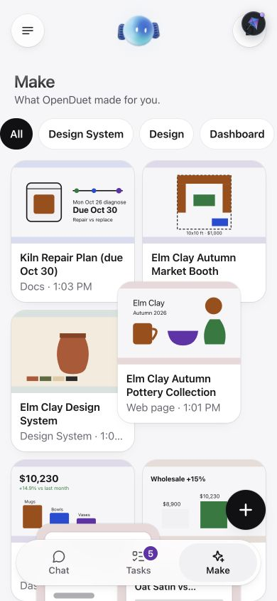
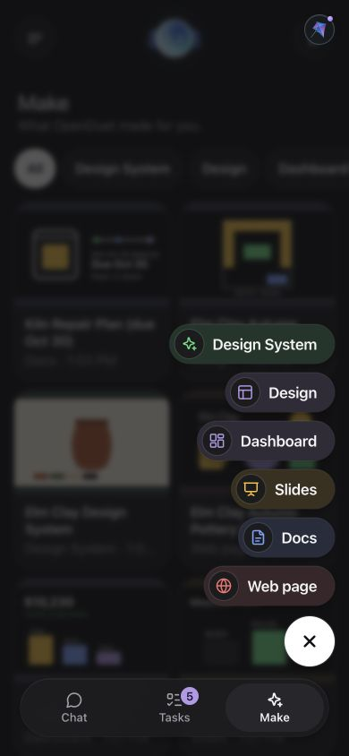
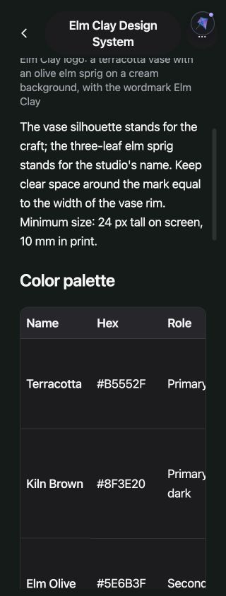
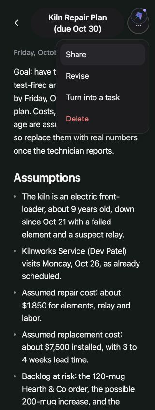
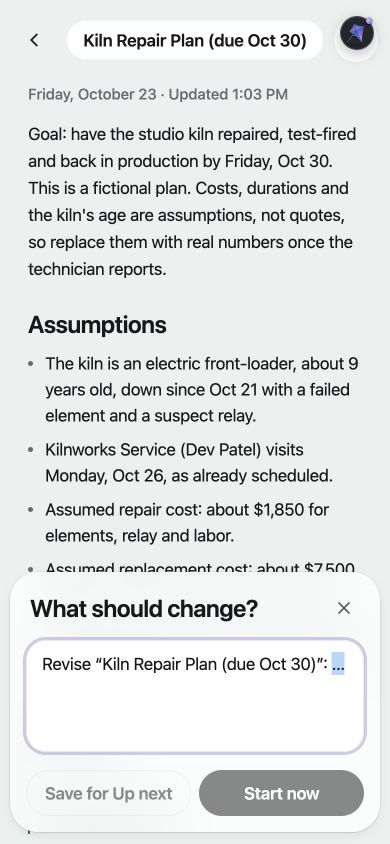
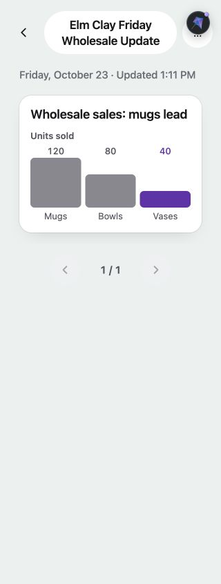
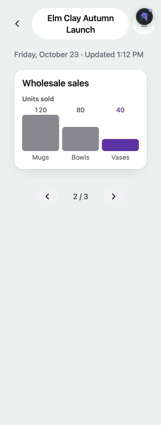

# Live page / Make verification — October 23, 2026

Verified against the isolated fake stack at app `localhost:3041`, server `localhost:3141`. The examples were requested through Make's + sheet and generated by the Bot; they were not inserted as test fixtures. The Make reference supplies Design System, Design, Dashboard, Slides, Docs, and Web page.

| Make choice | Bot-made result | Verified filter |
|---|---|---|
| Design System | Elm Clay Design System | Design System |
| Design | Elm Clay Autumn Market Booth | Design |
| Dashboard | Wholesale sales by category | Dashboard |
| Slides | Elm Clay: October Wholesale | Slides |
| Docs | Kiln Repair Plan (due Oct 30) | Docs |
| Web page | Elm Clay Autumn Pottery Collection | Web page |

Each has its own SVG thumbnail: kiln and due date, pottery logo, booth floor plan, pottery collection, category sales chart, wholesale figures. The kiln document uses timeline, checklist and decision blocks. The booth design uses SVG image, comparison, table, decision and checklist blocks. The design system uses an SVG image, palette and type tables, and checklist. This covers all six new block types from natural asks.

- Checked “Confirm kiln is powered off and tagged out of service”, fully reloaded the page, and confirmed it remained checked.
- Tested at 320, 390, and 430 px wide (844 px tall): document scroll width equalled the viewport at every width. At 320, a four-column table scrolled within a 262 px container and its first column was `position: sticky`.
- Verified light and dark. All six Make pills measured exactly 44 px high after the entrance animation. Measured computed text/background colors give a minimum contrast ratio over 12:1 in light and over 11:1 in dark.
- Verified Share showed “Link copied”; Revise opened with “Revise ‘Kiln Repair Plan (due Oct 30)’: …” and disabled submission until edited. IDs and tool names are kept out of the editable starter. Unit tests also exercise task conversion and deletion.
- The local development CopilotKit inspector floats above the top-right page action button. Keyboard Enter opens the action button correctly; screenshots include the inspector launcher. This is a development overlay, not page layout overflow.
- Restored the browser's original Match phone appearance and reset the temporary viewport override after verification.

## Evidence

Additional captures cover the light pills, dark grid, live checklist, 320 px booth design and 430 px design system.

## Deck follow-up verification (#58)

Two additional natural asks through Make's Slides choice produced the exact requested counts:

- “Make exactly one slide for Elm Clay’s Friday wholesale update: mugs sold 120, bowls sold 80, vases sold 40. Show the sales comparison clearly and keep it to one slide.” produced **Elm Clay Friday Wholesale Update**, one slide.
- “Make exactly three slides for Elm Clay’s autumn launch: 1) collection: moss mugs, sand bowls, rust vases; 2) wholesale sales: mugs 120, bowls 80, vases 40; 3) next week: photograph the collection, pack wholesale orders, confirm the market table. Keep it to three slides.” produced **Elm Clay Autumn Launch**, three slides.

At 320 px, the chart caption measured 13 px font size and 16 px rendered line height, with scale 1. The document's scroll width was 320 px. Navigating all three slides showed the requested collection, chart, and next steps, with no isolated heading or continuation title.

